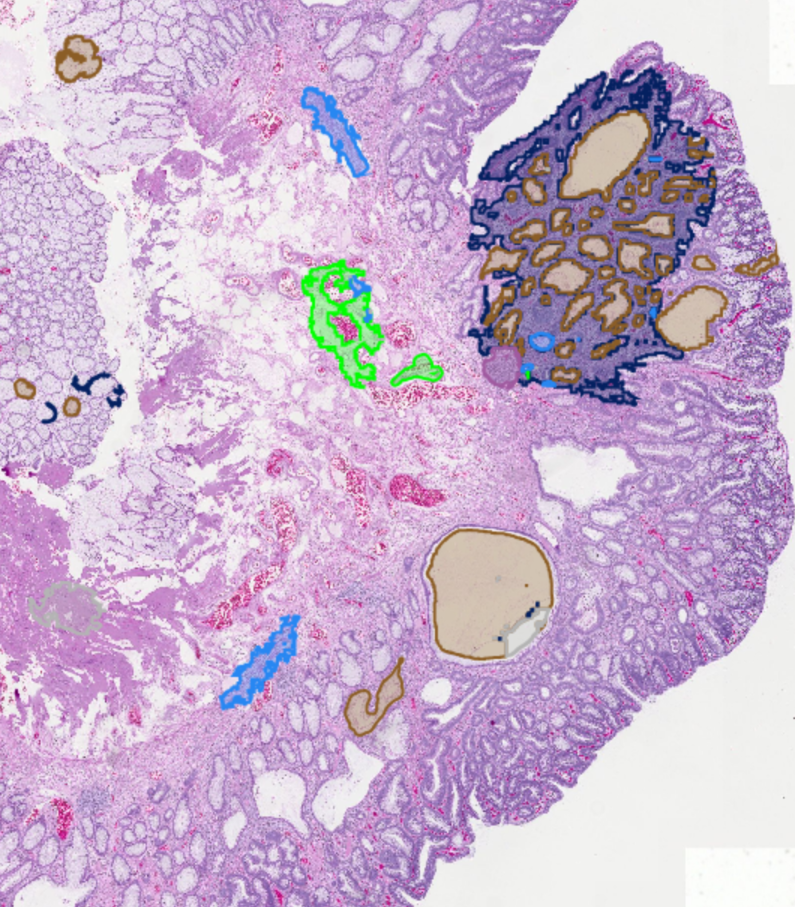

# QuPath Deep Learning Pixel Classifier Extension

A QuPath extension for deep learning-based pixel classification, supporting both brightfield (RGB) and multi-channel fluorescence/spectral images.

> **Research use only.** This extension is a research tool. It is not a diagnostic device, has not been cleared for clinical use, and produces results that are not validated for patient care. Models trained or loaded with this extension must not drive clinical decisions.

---

> **WARNING: Hardware Requirements**
>
> Deep learning models are computationally demanding. The models available in this extension -- particularly **MuViT**, histology-pretrained encoders, and larger ResNet variants (ResNet-50, ResNet-101) -- were originally trained on large GPU clusters over extended periods. Running them on a typical workstation pushes hardware limits quickly.
>
> **What to expect:**
> - **Without a dedicated NVIDIA GPU (CUDA)**, training will be extremely slow. Apple Silicon (MPS) can take 1-2+ hours per epoch (one pass through all training tiles) for larger models. CPU training is impractical for anything beyond toy experiments.
> - **Larger models + larger tile sizes + larger batch sizes = more memory.** It is easy to exceed your graphics card's memory (VRAM), causing QuPath to hang or crash. If training becomes unresponsive, you may need to **force-close QuPath** via Task Manager / Activity Monitor.
> - **Start small.** Use ResNet-18 or ResNet-34 with 256px tiles and a small batch size (2-4) first. Only scale up if your hardware handles it comfortably.
> - **Monitor your system resources** (GPU memory, CPU usage) during training, especially the first time with new settings.
>
> Running deep learning inside QuPath does not reduce what training a neural network costs. Choose your model architecture and training parameters to fit the hardware you have.

---

## Features



*Sparse brush annotations are enough to start: the extension samples training tiles from the regions you mark.*

### Train your own classifier
- Train custom pixel classifiers from sparse annotations: draw a few regions per class, the extension samples training tiles from them
- Train across multiple project images in one run for more representative sampling
- Works on brightfield (RGB) and multi-channel fluorescence/spectral images, with per-channel normalization
- Eliminate tile-boundary artifacts by computing normalization statistics over the whole image instead of per tile
- Choose your encoder backbone: ResNet / EfficientNet / MobileNet (UNet), or MuViT (multi-scale Vision Transformer with multi-resolution feature fusion)
- Start from histology-pretrained weights (TCGA, Lunit, Kather100K) instead of ImageNet, for better tissue features out of the box
- Use foundation-model encoders for richer features: h-optimus-0, virchow, hibou-l, hibou-b, midnight, dinov2-large; downloaded on demand from HuggingFace, all under commercially-permissive licenses (Apache 2.0, MIT). Integration inspired by LazySlide (Zheng et al. 2026, Nature Methods)
- Tune the training recipe after clicking **Show All Settings**: the scheduler is in Learning Rate & Optimizer, the loss in Loss Function, early stopping and its patience in Duration & Stopping, and mixed precision in Batch Size & Memory
- Learns region shapes well by default: the default loss scores both individual pixels and the overlap of whole regions
- Stops training when the overlap between its predictions and your validation annotations stops improving, rather than when the loss number stops falling
- Trains about twice as fast on NVIDIA GPUs (mixed precision)
- Reuse a previous model's settings for fast retraining iterations, with class auto-matching

### Pretrain and adapt to your data
- Adapt a trained model to a new microscope, stain or acquisition batch: **Utilities > Calibrate model to current image...** re-tunes the model to a new image in seconds, with no new annotations and no retraining (not available for MuViT models). See the [Domain Adaptation Guide](docs/DOMAIN_ADAPTATION_GUIDE.md)

<details>
<summary>Advanced pretraining</summary>

- MAE pretraining for MuViT: masked-autoencoder self-supervised pretraining on your own unlabeled tiles, using tiles drawn from annotation classes you choose. Domain-adaptive pretraining can seed MAE from a prior encoder
- **Developer-only:** SimCLR / BYOL self-supervised pretraining for CNN backbones is available behind the "Show Developer Pretraining Options" preference. SSL pretraining is collapse-prone on small datasets and is rarely the right tool for end-user workflows; MAE is the recommended path for most users

</details>

### Run inference
- Pick your output in the Apply dialog: per-class area measurements on each annotation (MEASUREMENTS), or detection or annotation objects (OBJECTS). Preview the result live with **Toggle Prediction Overlay**
- Each tile is classified with a margin of the surrounding image, and only its center is kept, which reduces seams at tile edges
- Out-of-distribution check: warns before inference when the image's pixel distribution (mean, contrast, dynamic range) differs significantly from the training data, helping you catch gross appearance shifts (stain, exposure, sensor changes) that could degrade predictions

### Inspect and iterate
- Find your worst annotations and hardest tiles automatically: post-training evaluation runs the model over every training tile, ranks by loss, and renders per-tile loss heatmaps and disagreement maps as viewer overlays. Sessions save per classifier version and reload without re-running
- See which classes the model confuses: a Confusion Matrix tab compares your annotations with the predictions, pixel by pixel; click a cell to list the tiles where that confusion happens. See [Confusion Matrix tab](docs/TRAINING_GUIDE.md#confusion-matrix-tab)
- Refine annotations from the model's suggestions, previewing each change before it is applied. See [Annotation Adjustment](docs/TRAINING_GUIDE.md#annotation-adjustment)
- See training progress live with separate train and validation loss charts
- See what each setting costs before you train: the **Training HUD** button in the Train dialog opens a live panel that names your last change and shows its effect on GPU memory, RAM cache, epoch speed, and learning steps (blue = better, orange = worse). Use its "vs" menu to measure against where you started, a loaded profile, or settings you pinned instead of the last edit. See the [Training Guide](docs/TRAINING_GUIDE.md#training-hud-see-what-a-change-did), and the [walkthrough on the workshop data](docs/TRAINING_HUD_WALKTHROUGH.md) for two presets compared

### Automate and reproduce
- Run from Groovy scripts for batch processing across a project, with the builder API for full control of each setting
- The Train and Apply dialogs each have a button (**Copy as Groovy Script** in Train, **Copy as Script** in Apply) that turns a configured run into a reproducible Groovy script
- Save and load training profiles: export your tuned training configuration (parameters, channel setup, name/description) to a JSON file for reuse across projects without retraining. **Note:** Class selection is not restored from profiles — classes always come from your current data loaded in the dialog
- Settings persist across sessions so you don't re-enter the same training and inference parameters every time

## Installation

1. **Download** the latest JAR from the [GitHub Releases](https://github.com/uw-loci/qupath-extension-dl-pixel-classifier/releases) page
2. **Install** the JAR using one of these methods:
   - **Drag and drop** the JAR file directly onto the open QuPath window (easiest), or
   - **Copy** the JAR manually to your QuPath extensions directory:

| OS | Extensions path |
|----|----------------|
| Windows | `C:\Users\<you>\QuPath\v0.7\extensions\` |
| macOS | `~/QuPath/v0.7/extensions/` |
| Linux | `~/QuPath/v0.7/extensions/` |

3. **Restart QuPath** -- the extension appears under **Extensions > DL Pixel Classifier**

> **Tip:** These are QuPath's default locations. If you chose a different QuPath user directory, **Edit > Preferences > Extensions** shows the extensions directory path.

See [docs/INSTALLATION.md](docs/INSTALLATION.md) for detailed instructions and GPU configuration.

## Getting Started


*Five ways into training, one route that skips it, and three ways out. Rendered from
[`docs/images/workflow-map.spec`](docs/images/workflow-map.spec) by
`tools/render_workflow_map.py` -- edit the spec, not the PNG.*


1. **Set up the Python environment** -- go to **Extensions > DL Pixel Classifier > Setup DL Environment...** in the QuPath menu bar. This downloads and configures PyTorch and all dependencies automatically (~2-4 GB, first time only). When it finishes, the dialog reads **Environment setup complete!** and the Train and Apply items appear in the menu.

   The wizard checks for an NVIDIA GPU and asks which environment to install:

   - **GPU (CUDA)** -- strongly recommended, and preselected when a GPU is found. Training and inference are many times faster.
   - **CPU** -- installs on any machine, but training is slow enough to be impractical on real data.

   If the GPU environment cannot be installed (no NVIDIA GPU, or a driver too old for CUDA 12), setup **falls back to CPU automatically** rather than leaving you with nothing, and tells you it did. See [GPU Support](#gpu-support).

2. **Changing CPU/GPU later** -- **Extensions > DL Pixel Classifier > Utilities > Compute Environment (CPU / GPU)...** switches variants. The setup wizard also offers a one-click switch on its completion screen whenever you end up on CPU. The two variants install side by side, so the one you switch away from is kept: the first switch to a variant downloads it (~2-4 GB), and switching back to one you already have does not. Once the new environment works, you are asked whether to remove the old one. Trained classifiers and settings are unaffected.

   > **After updating the extension:** the Python environment has to match the new version. By default the extension rebuilds it in the background the first time QuPath starts with the new version; the workflow menu items come back when it finishes. If you turned off **Auto-Rebuild Environment on Update** in the preferences, or the automatic rebuild fails, open **Extensions > DL Pixel Classifier > Utilities > Rebuild DL Environment...**

3. **Train a classifier:**
   1. **Draw annotations** of at least two classes, then **File > Save**. Training reads the copy the project has saved for each image, not what is on screen, so annotations you have just imported or drawn are invisible to it until you save. The dialog warns when it sees more classified annotations in the viewer than the project has stored.
   2. **Open Extensions > DL Pixel Classifier > Train DL Pixel Classifier...** The dialog starts in a simplified Basic mode; click **Show All Settings** for every option.
   3. **Tick the images** to train on.
   4. **Click Load Classes from Selected Images.** The rest of the dialog unlocks.
   5. **Type a name** in Name Your Classifier (the last section).
   6. **Click Start Training.** A progress window opens with a loss chart.

   New to the terms (epoch, batch, loss, IoU)? See [Words used in these guides](docs/TRAINING_GUIDE.md#words-used-in-these-guides).

   > **Note:** When training from scratch (tiny-unet or without pretrained weights), an advisory appears beneath the Epochs spinner recommending a minimum epoch count. This is advice only — the spinner value is always what trains. You are free to follow the recommendation or set a different value.

4. **Apply the classifier** -- open **Extensions > DL Pixel Classifier > Apply DL Pixel Classifier...**, select a model, choose an output type, and click Apply

See [QUICKSTART.md](QUICKSTART.md) for a complete walkthrough (zero to classifier in ~10 minutes).

### Report bugs

If you encounter an issue or have feedback, use the built-in bug reporter:

1. **Open Extensions > DL Pixel Classifier > Report a Bug...**
2. Fill in the fields below and submit.

This dialog requires:
- **Summary** (8-80 characters): a one-line description of the issue, which becomes the GitHub issue title
- **Description** (minimum 20 characters): a detailed explanation of the problem

Optionally include:
- **GitHub username**, e.g. `alice` or `@alice`. You are mentioned in the public issue, so you receive notifications
- **image.sc username**, your forum name, also visible in the public issue
- System information (versions, OS)
- QuPath logs
- Window screenshot

> **Important:** Reports are filed **anonymously**. The issue is created by the reporting service rather than from your account, so you will **not** be notified of replies unless you either:
> - Add a GitHub username to the optional contact fields (which mentions you on the issue and triggers notifications), or
> - Comment on the issue yourself on GitHub after it's created.

Filing a report needs no GitHub account. "Open the issue in my browser after submitting" is
checked by default; uncheck it if you would rather not have a browser window open -- the
success dialog links the issue either way.

### Recommended workflow: separate training and production projects

> **Keep your annotated training data in a dedicated "training project" and apply the finished classifier in a separate "production project."**
>
> Training projects contain your carefully curated annotations -- the ground truth your model learns from. Running inference (especially OBJECTS output) in the same project adds thousands of generated objects alongside your annotations, making it difficult to retrain or refine the classifier later. Instead, once you are satisfied with a trained model, copy it to a production project and apply it there across all your images. This keeps your training data clean for future iterations and lets you freely re-run or compare classifiers in the production project without risk.
>
> See [Best Practices: Training vs. Production Projects](docs/BEST_PRACTICES.md#training-vs-production-projects) for details, and [Tips and Tricks: Sharing and Moving Models](docs/TIPS_AND_TRICKS.md#sharing-and-moving-models-between-projects) for how to move classifiers between projects.

## Requirements

- QuPath 0.7.0+
- **Windows 10+ (64-bit)**, **Linux (64-bit)**, or **macOS Apple Silicon (M1+)**
- (Optional) NVIDIA GPU with CUDA if you select the GPU environment variant; CPU environment works on any machine without a GPU
- Internet connection for first-time environment setup (~2-4 GB download)

> **Not supported:** Intel Macs (x86_64 macOS) and 32-bit systems. See [Installation Guide](docs/INSTALLATION.md) for full platform details.

> **Note:** A separate Python installation is **not** required. The extension manages its own embedded Python environment via [Appose](https://github.com/apposed/appose).

### CUDA / GPU Driver Requirements

**This section applies only if you install the GPU environment variant.** The CPU environment requires no GPU or drivers, and is the automatic fallback when the GPU environment cannot be installed.

If you choose the **GPU variant**, the extension bundles **PyTorch with CUDA 12** support. You do **not** need to install CUDA separately -- PyTorch includes its own CUDA runtime. However, you **do** need NVIDIA drivers new enough to support CUDA 12:

| Component | Version |
|-----------|---------|
| Python | 3.11 |
| PyTorch | >= 2.1.0 (currently resolves to ~2.10) |
| CUDA (bundled with PyTorch) | 12.x |
| **Minimum NVIDIA driver (Linux)** | **>= 525.60.13** |
| **Minimum NVIDIA driver (Windows)** | **>= 528.33** |

To check your NVIDIA driver version, run `nvidia-smi` in a terminal. If your driver is too old, update it from the [NVIDIA Driver Downloads](https://www.nvidia.com/en-us/drivers/) page.

**Apple Silicon (M-series):** Choose the CPU variant -- the GPU variant is CUDA and will not install. When the installed PyTorch reports that the Mac's GPU (MPS) is available, training and inference use it automatically; **Utilities > System Info...** shows "MPS available" and the active device. Expect training to be slow either way; see the note at the top.

**Intel Mac:** Not supported. Use Windows or Linux with an NVIDIA GPU for best results.

## Documentation

| Guide | Description |
|-------|-------------|
| [Quickstart](QUICKSTART.md) | Zero-to-classifier in 10 minutes |
| [Installation](docs/INSTALLATION.md) | Full setup: extension install + Python environment + GPU configuration |
| [Training Guide](docs/TRAINING_GUIDE.md) | Step-by-step training workflow how-to |
| [Training HUD walkthrough](docs/TRAINING_HUD_WALKTHROUGH.md) | One real dataset (the BINA / I2K workshop tiles), two settings and two presets, and what the Training HUD shows for each |
| [Inference Guide](docs/INFERENCE_GUIDE.md) | Step-by-step inference workflow how-to |
| [Parameters](docs/PARAMETERS.md) | Every parameter with defaults, ranges, and ML guidance |
| [Scripting](docs/SCRIPTING.md) | Groovy API, builder pattern, batch processing, Copy as Script |
| [Best Practices](docs/BEST_PRACTICES.md) | Backbone selection, annotation strategy, hyperparameter tuning |
| [Troubleshooting](docs/TROUBLESHOOTING.md) | Environment issues, GPU issues, training/inference issues, diagnostics |
| [Preferences](docs/PREFERENCES.md) | All persistent preferences with defaults and keys |
| [Tips and Tricks](docs/TIPS_AND_TRICKS.md) | Practical workflow tips: quick runs to fix annotations, tile size, sharing models |
| [Domain Adaptation Guide](docs/DOMAIN_ADAPTATION_GUIDE.md) | What to do when a classifier does not work on images from a new microscope, stain or batch |
| [Appose Dev Guide](docs/APPOSE_DEV_GUIDE.md) | Constraints and patterns for embedded Python scripts (developer reference) |
| [Normalization round-trip contract](docs/NORMALIZATION_ROUNDTRIP.md) | Rules for any change to preprocessing, so training and inference stay in step (developer reference) |
| [Context and downsample design](docs/CONTEXT_AND_DOWNSAMPLE_DESIGN.md) | How Resolution, Surrounding context and context padding shape tiles (developer reference) |
| [Python Library](python_server/README.md) | Python deep learning library (training, inference, models) |

## GPU Support

The extension has **two separate Python environments**. The setup wizard asks which one to install, checks for an NVIDIA GPU, and preselects GPU when it finds one. You can also set it directly in **Edit > Preferences > DL Pixel Classifier > "Python environment: compute variant"**, or change it later from **Utilities > Compute Environment (CPU / GPU)...**:

- **CPU**: works on any machine, with no GPU acceleration. Training is much slower but functional. Choose it if you have no NVIDIA GPU or want the widest compatibility; it is also the automatic fallback when the GPU environment cannot be installed.
- **GPU (CUDA)**: uses an NVIDIA GPU for training and inference. **Requires an NVIDIA GPU AND CUDA-compatible drivers. The environment cannot install without one.** See [CUDA / GPU Driver Requirements](#cuda--gpu-driver-requirements) below.

Each variant installs as a separate environment (~2-4 GB) under its own name, so both can be installed at once. The first switch to a variant downloads it; switching back to one you already have does not. See [docs/TROUBLESHOOTING.md](docs/TROUBLESHOOTING.md) for GPU detection issues or if your GPU is not being used.

**Choosing a GPU on a multi-GPU machine.** Training and inference run on one NVIDIA card. The preference **Edit > Preferences > DL Pixel Classifier > "Python environment: GPU device (all Appose extensions)"** chooses which one. `auto` (the default) picks the card with the most free memory when the first worker starts; a number is the index `nvidia-smi` shows. The setting is shared with the other Appose extensions and applies to workers started after the change (restart QuPath to apply it to a running worker). If QuPath was started by a cluster scheduler that sets `CUDA_VISIBLE_DEVICES`, `auto` keeps that allocation. The cards found and the one chosen are written to the QuPath log when a worker starts.

## Supported Image Types

| Image Type | Channels | Bit Depth | Strategy |
|------------|----------|-----------|----------|
| Brightfield RGB | 3 | 8-bit | Direct input |
| Immunofluorescence | 2-8+ | 8/12/16-bit | Channel selection + normalization |
| Spectral/Hyperspectral | 10-100+ | 16-bit | Channel grouping |

<details>
<summary><h2>Architecture</h2></summary>

```
qupath-extension-dl-pixel-classifier/
|-- src/main/java/qupath/ext/dlclassifier/
|   |-- SetupDLClassifier.java        # Extension entry point & menu management
|   |-- DLClassifierChecks.java       # Startup validation
|   |-- classifier/                    # Classifier type system
|   |   |-- ClassifierHandler.java
|   |   |-- ClassifierRegistry.java
|   |   `-- handlers/
|   |       |-- UNetHandler.java
|   |       |-- MuViTHandler.java
|   |       `-- CustomONNXHandler.java
|   |-- controller/                    # Workflow orchestration
|   |   |-- DLClassifierController.java
|   |   |-- TrainingWorkflow.java
|   |   |-- InferenceWorkflow.java
|   |   `-- ModelManagementWorkflow.java
|   |-- service/                       # Backend services
|   |   |-- ApposeService.java        # Appose embedded Python management
|   |   |-- ApposeClassifierBackend.java  # Appose backend implementation
|   |   |-- ClassifierBackend.java    # Backend interface
|   |   |-- ClassifierClient.java     # Data records and utilities
|   |   |-- BackendFactory.java       # Backend initialization
|   |   |-- DLPixelClassifier.java    # QuPath PixelClassifier integration
|   |   |-- ModelManager.java
|   |   `-- OverlayService.java
|   |-- model/                         # Data objects
|   |   |-- TrainingConfig.java
|   |   |-- InferenceConfig.java
|   |   |-- ChannelConfiguration.java
|   |   `-- ClassifierMetadata.java
|   |-- utilities/                     # Processing utilities
|   |   |-- AnnotationExtractor.java  # Training data export (single + multi-image)
|   |   |-- TileProcessor.java
|   |   |-- ClassPixelCounter.java    # MEASUREMENTS: per-class pixel counts inside annotations
|   |   |-- BitDepthConverter.java
|   |   `-- OutputGenerator.java
|   |-- ui/                            # UI components
|   |   |-- TrainingDialog.java
|   |   |-- InferenceDialog.java
|   |   |-- SetupEnvironmentDialog.java   # First-time setup wizard
|   |   |-- ChannelSelectionPanel.java
|   |   |-- LayerFreezePanel.java
|   |   |-- ProgressMonitorController.java
|   |   |-- PythonConsoleWindow.java
|   |   |-- TrainingAreaIssuesDialog.java  # Post-training tile evaluation results
|   |   |-- MAEPretrainingDialog.java     # Standalone MAE pretraining config
|   |   `-- TooltipHelper.java
|   |-- scripting/
|   |   |-- DLClassifierScripts.java   # Groovy API
|   |   `-- ScriptGenerator.java       # Dialog-to-script generation
|   `-- preferences/
|       `-- DLClassifierPreferences.java
|
|-- python_server/                     # Python DL library (used by Appose)
|   `-- dlclassifier_server/
|       |-- services/                  # Training/inference services
|       `-- utils/                     # Shared utilities (normalization, etc.)
```

</details>

<details>
<summary><h2>For Developers</h2></summary>

Building the extension from source and running the Python tests are covered in [Installation, Part 5: Building from Source](docs/INSTALLATION.md#part-5-building-from-source-for-developers).

</details>

<details>
<summary><h2>Acknowledgments</h2></summary>

This extension builds on many excellent open-source projects and pretrained models.

### Segmentation Framework

- **[segmentation-models-pytorch (SMP)](https://github.com/qubvel-org/segmentation_models.pytorch)** (MIT) -- Pavel Iakubovskii. Provides the U-Net architecture and encoder backbone integration.
- **[PyTorch](https://pytorch.org/)** (BSD) -- Meta AI. Deep learning framework used for training and inference.
- **[TorchVision](https://docs.pytorch.org/vision/)** (BSD) -- PyTorch team. Provides ImageNet-pretrained backbone weights (ResNet, EfficientNet, MobileNet).

### Segmentation Architectures (via SMP)

| Architecture | Original Paper |
|---|---|
| U-Net | Ronneberger et al., "U-Net: Convolutional Networks for Biomedical Image Segmentation" (MICCAI 2015), [arXiv:1505.04597](https://arxiv.org/abs/1505.04597) |

### Encoder Backbones (via SMP + TorchVision)

| Backbone | Original Paper |
|---|---|
| ResNet | He et al., "Deep Residual Learning for Image Recognition" (CVPR 2016) |
| EfficientNet | Tan & Le, "EfficientNet: Rethinking Model Scaling for Convolutional Neural Networks" (ICML 2019) |
| MobileNet V2 | Sandler et al., "MobileNetV2: Inverted Residuals and Linear Bottlenecks" (CVPR 2018) |

### Histology-Pretrained Encoders

Histology-specific encoder weights are loaded via **[timm (PyTorch Image Models)](https://github.com/huggingface/pytorch-image-models)** (Apache 2.0) from the **[HuggingFace Model Hub](https://huggingface.co/)**, using weights curated by [1aurent](https://huggingface.co/1aurent):

| Encoder | Training Data | Method | License | Reference |
|---|---|---|---|---|
| ResNet-50 Lunit SwAV | 19M TCGA patches | SwAV self-supervised | Non-commercial | Kang et al., "Benchmarking Self-Supervised Learning on Diverse Pathology Datasets" (2023) |
| ResNet-50 Lunit Barlow Twins | 19M TCGA patches | Barlow Twins self-supervised | Non-commercial | Kang et al. (2023) |
| ResNet-50 Kather100K | Kather100K colorectal tissue | Supervised classification | CC-BY-4.0 | Kather et al., "Predicting survival from colorectal cancer histology slides using deep learning" (PLOS Medicine 2019) |
| ResNet-50 TCGA-BRCA | TCGA breast cancer | SimCLR self-supervised | GPLv3 | Ciga et al., "Self supervised contrastive learning for digital histopathology" (Machine Learning with Applications 2022) |

### Foundation Model Encoders

Foundation model integration inspired by **[LazySlide](https://github.com/rendeirolab/LazySlide)** (Zheng et al. 2026, Nature Methods, [doi:10.1038/s41592-026-03044-7](https://doi.org/10.1038/s41592-026-03044-7)). All included models use commercially-permissive licenses (Apache 2.0 or MIT). Models are downloaded on-demand from HuggingFace, not bundled.

| Encoder | Parameters | License | Reference |
|---|---|---|---|
| h-optimus-0 | 1.1B | Apache 2.0 | Bioptimus, "H-optimus-0" (2024) |
| virchow | 632M | Apache 2.0 | Vorontsov et al., "Virchow: A Million-Slide Digital Pathology Foundation Model" (2023), [arXiv:2309.07778](https://arxiv.org/abs/2309.07778) |
| hibou-l | 300M | Apache 2.0 | Nechaev et al. (HistAI), "Hibou: A Family of Foundational Vision Transformers for Pathology" (2024), [arXiv:2406.05074](https://arxiv.org/abs/2406.05074) |
| hibou-b | 86M | Apache 2.0 | Nechaev et al. (HistAI), "Hibou" (2024), [arXiv:2406.05074](https://arxiv.org/abs/2406.05074) |
| midnight | 1.1B | MIT | Karasikov et al. (kaiko.ai), "Training state-of-the-art pathology foundation models with orders of magnitude less data" (2025), [arXiv:2504.05186](https://arxiv.org/abs/2504.05186) |
| dinov2-large | 300M | Apache 2.0 | Oquab et al., "DINOv2: Learning Robust Visual Features without Supervision" (2024), [arXiv:2304.07193](https://arxiv.org/abs/2304.07193) |

### Data Augmentation

- **[Albumentations](https://github.com/albumentations-team/albumentations)** (MIT) -- Buslaev et al., "Albumentations: Fast and Flexible Image Augmentations" (Information 2020). Used for training-time augmentations (flips, rotations, elastic deformations, color jitter, noise).

### Model Export and Inference

- **[ONNX](https://onnx.ai/)** (Apache 2.0) -- Open Neural Network Exchange format for model serialization.
- **[ONNX Runtime](https://github.com/microsoft/onnxruntime)** (MIT) -- Microsoft. High-performance inference engine with CUDA, CoreML, and CPU backends.

### Java-Python Integration

- **[Appose](https://github.com/apposed/appose)** (Apache 2.0) -- SciJava. Shared-memory IPC framework for embedded Python execution with zero-copy tile transfer.

### Image I/O

- **[tifffile](https://github.com/cgohlke/tifffile)** (BSD) -- Christoph Gohlke. Multi-channel TIFF reader/writer for microscopy images.
- **[imagecodecs](https://github.com/cgohlke/imagecodecs)** (BSD) -- Christoph Gohlke. Image compression codec library.
- **[Pillow](https://python-pillow.org/)** (HPND) -- PIL fork for standard image format support.
- **[scikit-image](https://scikit-image.org/)** (BSD) -- Image processing algorithms.

### Host Application

- **[QuPath](https://qupath.github.io/)** (GPL-3.0) -- Bankhead et al., "QuPath: Open source software for digital pathology image analysis" (Scientific Reports 2017). The digital pathology platform this extension integrates with.

</details>

## License

This project is licensed under the Apache License 2.0 - see the [LICENSE](LICENSE) file for details.

## Support

For general support and feature requests, please post on the [image.sc forum](https://forum.image.sc/) with the `#qupath` tag and mention `@Mike_Nelson` to flag the topic for my attention.

## Contributing

Contributions welcome! Please open issues or pull requests on GitHub.

## AI-Assisted Development

This project was developed with assistance from [Claude](https://claude.ai) (Anthropic). Claude was used as a development tool for code generation, architecture design, debugging, and documentation throughout the project.
