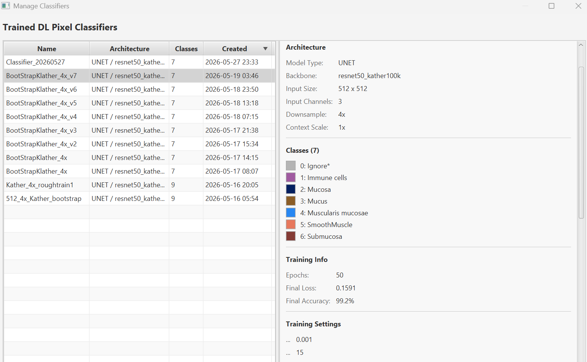
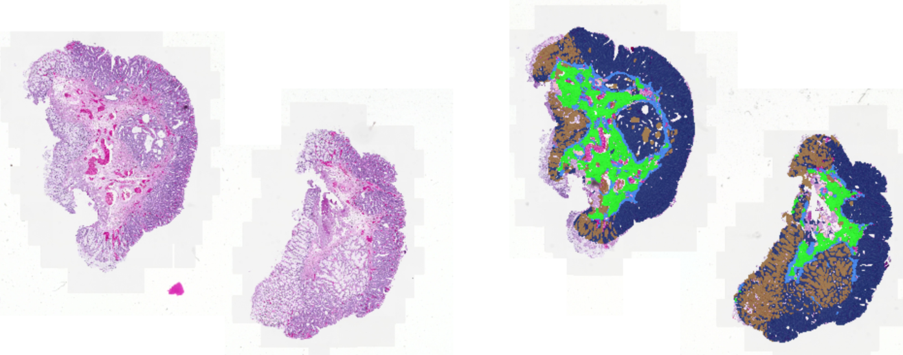

# Inference Guide

Step-by-step guide to applying a trained classifier to images.

## Overview

Inference applies a trained pixel classifier to new images, producing results as measurements, detection objects, or a color overlay.

## Step 1: Open an Image

Open the image you want to classify in QuPath. The image type (brightfield, fluorescence) should match what the classifier was trained on.

## Step 2: Open the Inference Dialog

Go to **Extensions > DL Pixel Classifier > Apply DL Pixel Classifier...**

## Step 3: Select a Classifier

The classifier table shows all available trained models with columns for:
- **Name**: classifier identifier
- **Type**: architecture (e.g., unet, muvit)
- **Channels**: input channel count (with context scale info, e.g., "3 +2x ctx")
- **Classes**: number of output classes
- **Trained**: training date

The table defaults to sorting by **Trained** date, newest first, so the most recently trained classifier appears at the top. Click any column header to re-sort by that column (click again to reverse the order).

Click a row to select it. The info panel below shows the architecture + backbone, input channels + context scale + tile dimensions, downsample level, and class names.

The figure below shows the **Manage Classifiers** window, which lists the same classifiers and details.

### Channel Mapping

The **CHANNEL MAPPING** section shows how the classifier's expected channels map to the current image. Each row displays:
- **Expected** channel name from the classifier
- **Mapped To** the image channel it will use
- **Status**: [OK] (exact match), [?] (fuzzy/substring match), or [X] (unmapped)

For unmatched channels, use the dropdown to manually remap to the correct image channel. For brightfield images, channels are auto-configured and this section collapses automatically.

## Step 4: Configure Output Type

| Output Type | Description | Best for |
|-------------|-------------|----------|
| **MEASUREMENTS** | Adds, for each class, its area (um^2) and its share (%) of the annotation, counted from the same per-pixel classification the overlay and OBJECTS use, plus `DL: Total pixels` (pixels classified inside the annotation, at the model's resolution) | Quantification (% area per class) |
| **OBJECTS** | Creates detection or annotation objects from the classification map. Uses the same unified inference pipeline as the overlay, predictions are identical. | Spatial analysis, counting structures |

How MEASUREMENTS are counted:

- The pixels are the model's output pixels, one per *downsample* x *downsample* image pixels. A pixel counts when its center lies inside the annotation.
- Area = count x (image pixel size x downsample)^2. % = the class's share of all counted pixels.
- Ignored classes (QuPath's convention: a name ending in `*`, such as `Ignore*`) get their own columns and count toward the %; they produce no objects in OBJECTS output.
- Min/Max Object Size, Hole Filling and Boundary Smoothing do not apply, so these areas will not equal summed OBJECTS areas.
- On an image with no pixel calibration the extension assumes 1 um per pixel, so the `um^2` columns are really square pixels. Set the pixel size first.

OBJECTS holds a class map of each annotation's whole bounding box in memory. An annotation whose map would need more than half of QuPath's free memory is refused; see [This annotation is too large for Objects output](TROUBLESHOOTING.md#this-annotation-is-too-large-for-objects-output).

### Object output options (OBJECTS only)

| Option | Description | Typical value |
|--------|-------------|---------------|
| **Object Type** | DETECTION (lightweight) or ANNOTATION (editable) | DETECTION for quantification |
| **Min Object Size** | Discard objects smaller than this area (um^2) | 10-100 um^2 |
| **Max Object Size** | Discard objects larger than this area (um^2); 0 = no limit | 0 (off), or set to drop mis-merged sheets |
| **Hole Filling** | Fill holes smaller than this area (um^2) | 5-50 um^2 |
| **Boundary Smoothing** | Simplify jagged boundaries (tolerance in micrometers, um) | 0.5-2.0 um |
| **Add shape measurements** | Attach circularity and solidity to each object | ON when filtering objects by shape |

### Touching objects of the same class

Every contiguous patch of one class becomes one object, so two touching cells of the same class come out as a single object. That is right for continuous regions (a tumor area, a tissue compartment). Automatic splitting is not offered in the dialog: it has not been validated on real data. To keep touching objects apart, either:

- Split them in QuPath after creation, with the standard object tools.
- Train an explicit *boundary* class: annotate the gaps between objects so their interiors come out already separated. This needs no change to the model type, only to the annotations.

## Step 5: Configure Processing Options

These options are collapsed by default. Expand **PROCESSING OPTIONS** to adjust.

| Option | Default | Description |
|--------|---------|-------------|
| **Tile Size** | Auto-set from classifier | Should match training tile size. Range: 64-8192. |
| **Tile Overlap (%)** | 12.5% | Margin of real image read on each side of a tile. Higher = fewer seams but slower (max 50%). See below. |
| **Blend Mode** | GAUSSIAN | Every mode keeps only the center of each tile. CENTER_CROP also widens each tile's margin to at least 25% of the tile, which removes rectangular blocks of the wrong class that line up with the tile grid but needs about twice as many tiles at the default overlap. GAUSSIAN, LINEAR and NONE use your overlap as set and give the same result. See [Rectangular blocks of the wrong class](TROUBLESHOOTING.md#rectangular-blocks-of-the-wrong-class-aligned-to-a-grid). |
| **Use GPU if available** | Yes | Saved with your settings. In this release inference uses the GPU whenever the environment can, whatever this box says. |
| **Test-Time Augmentation (TTA)** | No | Runs each tile 8 times (flipped and rotated) and averages the answers. About 8x slower; the tooltip estimates 1-3% better quality. Best for final runs. |

### Tile overlap and context

The overlap sets how many pixels of real image the model sees around each tile's kept center. The overlay and Apply DL Pixel Classifier compute it the same way: your overlap is used as set, limited only so the kept center is at least one pixel wide. The one exception is Blend Mode CENTER_CROP, which raises the margin to 25% of the tile.

The kept center (the stride) is `tileSize - 2 * margin`. For a 512 px tile at the default 12.5%, the margin is 64 px on each side and the stride is 384 px; with CENTER_CROP the margin is 128 px and the stride 256 px.

How tiling and normalization work (background)

### Expanded reads (real context)

Each tile is read from the image as a tileSize-sized region (not just the stride portion). This provides the model with **real neighboring pixel data** at every tile boundary, no artificial reflection padding. The output is center-cropped to the stride region, discarding edge predictions where the model has less context. This follows the recommendation from Buglakova et al. (ICCV 2025): "Completely remove halo region during stitching."

For multi-scale (context-scale) models, the tile read is expanded further, and a second downsampled "context" tile is reconstructed live from the image. The exact geometry, and how it must line up with how training tiles and the per-tile Training Area Issues preview were built, is documented in [Context and Downsample Design](CONTEXT_AND_DOWNSAMPLE_DESIGN.md).

### Unified pipeline (overlay = objects)

The **OBJECTS** and **MEASUREMENTS** outputs and the **overlay** use the same inference pipeline. This gives identical predictions: same expanded reads, same normalization, same model input, same center-crop, same Gaussian smoothing. The only difference is the output: the overlay renders pixels directly, OBJECTS traces the classification map into QuPath objects, and MEASUREMENTS counts its pixels.

### Image-level normalization

The extension automatically computes normalization statistics across the entire image before starting inference. This ensures all tiles receive identical input normalization, eliminating the "blocky" tile boundary artifacts that occur when each tile independently computes its own statistics.

**Priority order:**
1. **Training dataset statistics** (best), stored in model metadata for newly trained models
2. **Image-level sampling**: samples ~16 tiles in a 4x4 grid across the image (~1-3s one-time cost)
3. **Per-tile normalization**: fallback if sampling fails

This is fully automatic and requires no configuration. The normalization method itself (the strategy, and whether channels are normalized together or separately) always comes from the model, because changing it changes what the model sees: **Apply DL Pixel Classifier** shows the model's setting and does not let you change it.

### BatchRenorm (model-internal normalization)

Newly trained models use **BatchRenorm** instead of standard BatchNorm for the network's internal normalization layers (MuViT models use LayerNorm instead). Standard BatchNorm causes a train/eval disparity: running statistics accumulated during training diverge from actual tile statistics during inference, creating artifacts that no amount of overlap or blending can fix. BatchRenorm uses consistent global statistics in both modes, producing seamless tiled predictions. Older models trained with standard BatchNorm will continue to work but may exhibit more visible tile boundaries.

## Step 6: Set Application Scope

| Scope | Description |
|-------|-------------|
| **Apply to whole image** | Classify the entire image (no annotations needed) |
| **Apply to all annotations** | Classify within all annotations (default) |
| **Apply to selected annotations only** | Classify only within selected annotations |

> **Tip**: Use "Apply to selected annotations only" to test on a small region before processing the entire image.

With **Apply to whole image** and MEASUREMENTS, the extension adds a "Full Image" annotation to the image and puts the measurements on it.

Applying MEASUREMENTS again replaces the earlier `DL:` measurements of the same names. To keep the earlier results, duplicate the image in the project first, or export the measurements.

## Step 7: Apply

1. **Click Apply.** An **Applying Classifier** window shows progress.
2. When it finishes, the objects (OBJECTS) appear in the viewer and the Hierarchy tab, or the new `DL:` columns (MEASUREMENTS) appear in the annotations' measurement table.

*Left: input tissue sections. Right: the same sections after applying a trained classifier, with per-class predictions rendered as a color overlay.*

> **Note:** The dialog remembers output type, blend mode, smoothing, tile size, overlap, the GPU box, object type, min and max object size, hole filling, shape measurements and application scope across sessions.

## Live Overlay Mode

For quick visual inspection without the full inference dialog:

1. **Click Extensions > DL Pixel Classifier > Select Overlay Model...** and choose a trained classifier.
2. **Click Extensions > DL Pixel Classifier > Toggle Prediction Overlay.** Colored predictions appear over the image and fill in as you pan and zoom. Each tile keeps only its center, so tile edges do not show.
3. **Click Toggle Prediction Overlay again** to remove it. The model selection persists, so you can toggle it back on without choosing again.

If you toggle the overlay on without selecting a model first, you will be prompted to choose one.

The overlay's margin around each tile follows the **Tile Overlap** last set in the Train or Apply dialog (the two share one setting) and the **Blend Mode** last used in Apply DL Pixel Classifier.

### Overlay and classification settings

These are in **Edit > Preferences > DL Pixel Classifier**. Despite their names, both apply to the overlay **and** to Apply DL Pixel Classifier:

- **Overlay Prediction Smoothing** (sigma 0-10, default 2.0): Gaussian smoothing of the class probabilities before each pixel is assigned a class. It applies to OBJECTS and MEASUREMENTS too, so changing it changes measured areas. Use the same value for every image you intend to compare. Higher values reduce noisy per-pixel predictions, especially for ResNet/CNN models. MuViT/ViT models produce smoother predictions and may need less smoothing.
- **Overlay High-Quality Tile Averaging** (default off): Run each tile at 4 spatial offsets and average the predictions to eliminate tile boundary seams. About 4x slower.

Changes are applied immediately to the active overlay.

## Copy as Script

Click the **Copy as Script** button (left side of the button bar) to generate a Groovy script matching your current settings. The script does not carry **Overlay High-Quality Tile Averaging**. See [SCRIPTING.md](SCRIPTING.md) for batch processing.
