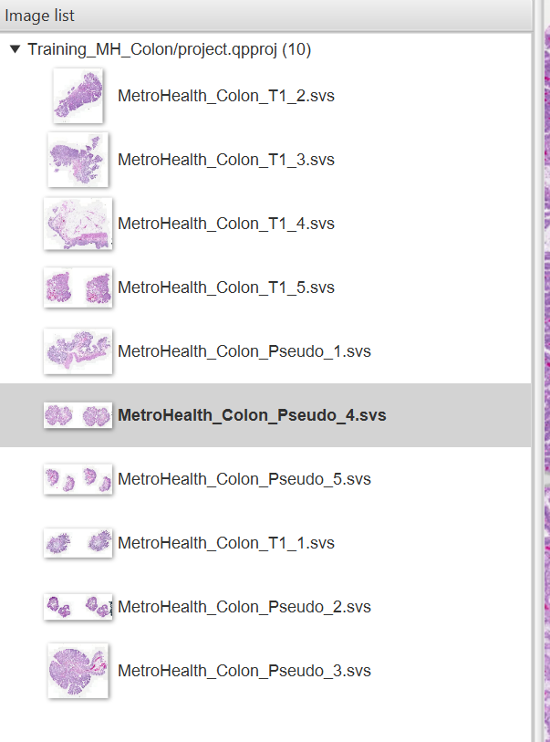
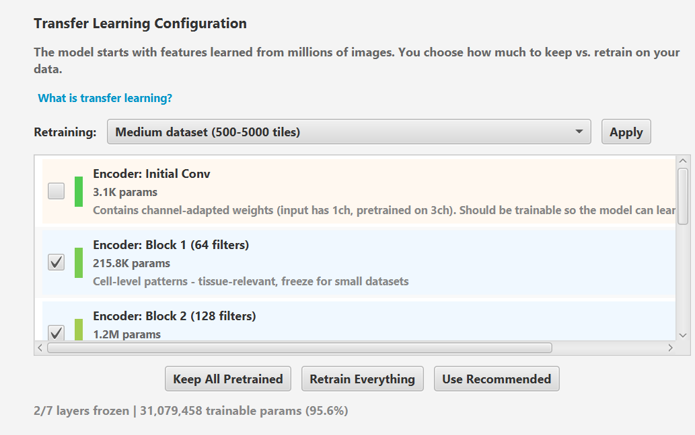
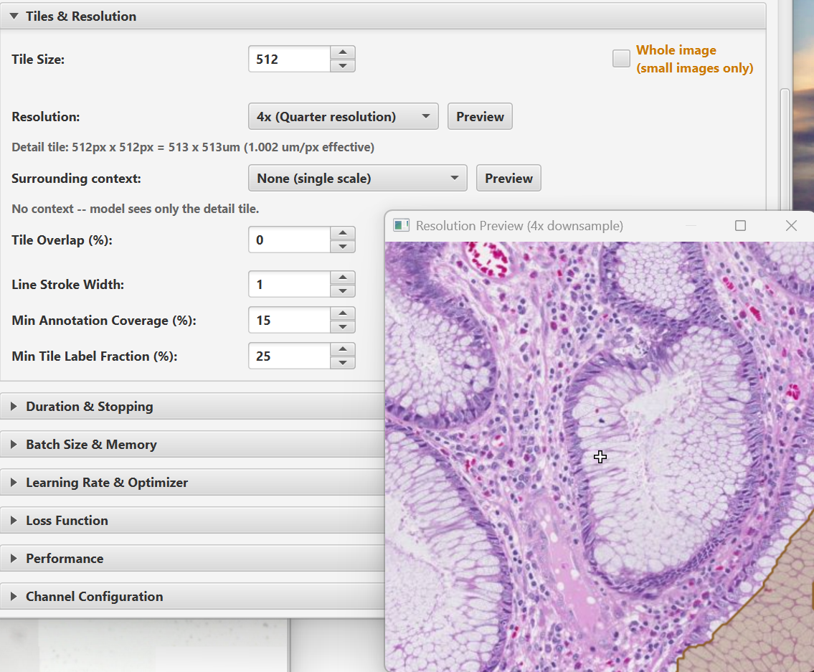
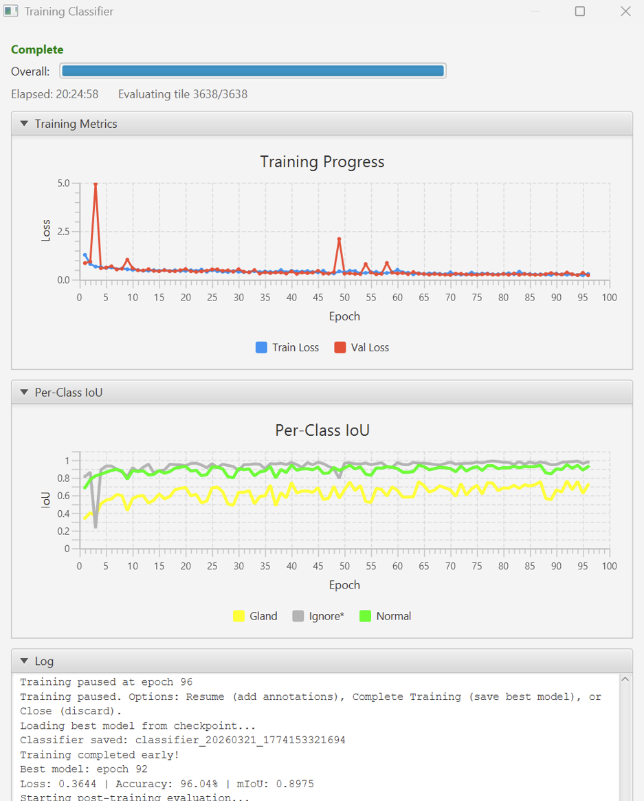
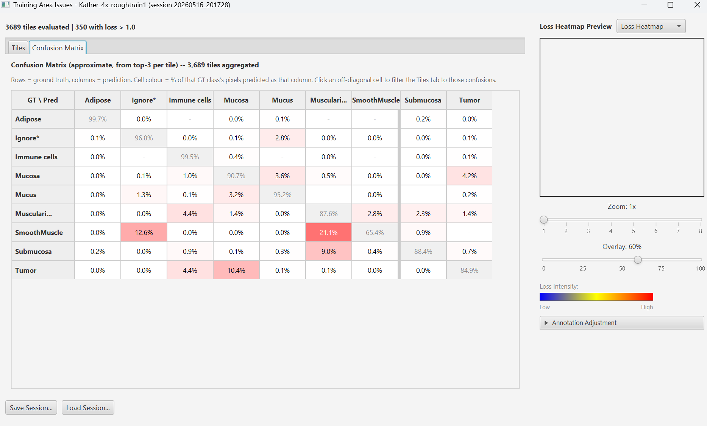
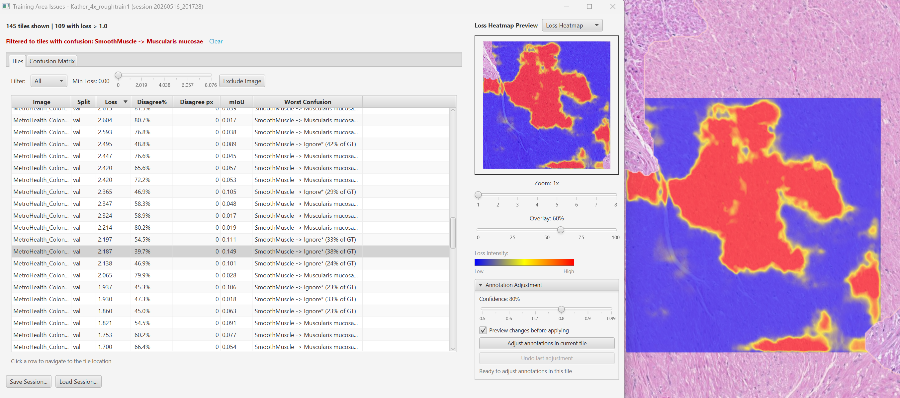

# Training Guide

Step-by-step guide to training a deep learning pixel classifier.

## Overview

Training a classifier involves:
1. Preparing annotated training data in QuPath
2. Configuring the model and training parameters
3. Running training with progress monitoring
4. Reviewing training areas to identify annotation issues (optional)
5. Continuing training if needed (optional)
6. Verifying the trained model

## Words used in these guides

- **Tile (patch):** a small square cut from your image. The model learns from, and predicts, one tile at a time.
- **Epoch:** one pass through every training tile.
- **Batch size:** how many tiles the model looks at before it adjusts itself once.
- **Learning step (weight update):** one such adjustment. Each epoch makes (training tiles / batch size, rounded up) of them, fewer when Gradient Accumulation is above 1, so a large batch on few tiles gives very few.
- **Training and validation tiles:** validation tiles are held back and never learned from. The scores on them estimate how the model will do on images it has not seen.
- **Loss:** the number training tries to make smaller. Lower means the predictions agree more with your annotations. Compare it within one run, not between runs.
- **IoU (intersection over union):** for one class, the area where the model and your annotation agree, divided by the area either of them calls that class. 1.0 is perfect agreement, 0 is none. **Mean IoU** averages it over the classes.
- **Encoder (backbone):** the part of the model that picks out edges, textures and shapes. **Pretrained** means it has already learned these from other images (everyday photos for ImageNet, H&E slides for the histology encoders).
- **Freezing a layer:** keeping that part of the pretrained encoder unchanged during training.
- **Overfitting:** the model memorizes the training tiles. Training loss keeps falling while validation loss rises.
- **GPU memory (VRAM):** the memory on the graphics card. Running out of it stops training.
- **Learning rate:** how large each adjustment is.
- **Mixed precision (AMP):** on NVIDIA GPUs, does part of the arithmetic at lower precision, which trains about twice as fast and uses less GPU memory.
- **Augmentation:** random flips, rotations and color changes applied to training tiles so the model does not depend on orientation or exact color.

## Step 1: Prepare Annotations

### Create annotation classes

1. Open an image in QuPath
2. Right-click in the annotation class list (left panel) to add classes
3. Create at least two classes (e.g., "Tumor", "Stroma", "Background")

### Draw annotations

1. Use the brush, polygon, or polyline tools to annotate regions
2. Assign each annotation to a class (right-click > Set class)
3. Annotate representative examples of each class throughout the image

### Annotation best practices

- **Quality over quantity**: A few well-placed annotations are better than many sloppy ones
- **Cover variability**: Include examples from different regions, staining intensities, and tissue morphologies
- **Balance classes**: Try to annotate roughly similar areas for each class
- **Include boundaries**: Annotate along class boundaries where the model needs to make decisions
- **Use brush annotations**: The brush tool is efficient for painting regions. Line annotations also work but require setting the line stroke width parameter

## Step 2: Open the Training Dialog

1. **Open Extensions > DL Pixel Classifier > Train DL Pixel Classifier...** The dialog opens in **Basic mode**: the image list, a model size (Fast, Small, Medium or Large), the weight initialization, epochs and the main tile and memory settings, the classes and the classifier name.
2. Optional: **click Show All Settings** in the title row to see every option. The dialog remembers your choice.

![Configure Classifier Training dialog in its advanced view. The title row holds Load profile..., Training HUD and Show Basic View buttons. Training Data Source lists the project images, each with a checkbox and a Train/Val role dropdown, above Select All, Select None, Auto-Distribute and All Both buttons, a Load Classes from Selected Images button, and an orange line giving the estimated training tiles and warning that the in-memory cache would exceed half of free RAM. Model Architecture holds an Architecture dropdown set to unet, a checkbox reading Only architectures with pretrained weights, and an Encoder dropdown set to ResNet-34. Weight Initialization offers Train from scratch, Continue from provided weights (selected, described as starting from ImageNet weights), Use MAE pretrained encoder, Use SSL pretrained encoder and Continue training one of your saved models, followed by a Transfer Learning Configuration panel with a Retraining preset dropdown and a scrolling list of encoder blocks with per-block freeze checkboxes and parameter counts. The remaining sections are collapsed, and a button row runs along the bottom: Copy as Groovy Script, Save profile, Reset to defaults, Start Training and Cancel](images/train-dialog-configure-classifier.png)

The dialog's sections, top to bottom:

1. **Training Data Source**: select images and load classes
2. **Model Architecture**: architecture and encoder selection
3. **Weight Initialization**: how to initialize model weights
4. **Tiles & Resolution**: tile size, resolution, surrounding context, overlap
5. **Duration & Stopping**: epochs, validation split, early stopping, focus class
6. **Batch Size & Memory**: batch size, gradient accumulation, mixed precision
7. **Learning Rate & Optimizer**: learning rate, scheduler (Show All Settings only)
8. **Loss Function**: loss and hard-pixel options (Show All Settings only)
9. **Performance**: in-memory dataset, progressive resizing and other speed options (Show All Settings only)
10. **Channel Configuration**: input channel selection and normalization
11. **Annotation Classes**: class selection and weight balancing
12. **Data Augmentation**: flip, rotation, intensity augmentation (Show All Settings only)
13. **Name Your Classifier**: name and description

## Loading Settings from a Previous Model

To pre-populate dialog settings from a previously trained classifier:

1. In the **Weight Initialization** section, select the **"Continue training one of your saved models"** radio button
2. Click **"Select model..."** to open the model picker
3. Select a model from the table (sorted by date, newest first)
4. Click **OK**

This populates:
- **Architecture, backbone, tile size, downsample, context scale, epochs** from the model metadata
- **Learning rate, batch size, augmentation, scheduler, loss function, early stopping, and all other hyperparameters** from the model's saved training settings
- **Classifier name** set to the original model's name (or `Retrain_<name>_YYYYMMDD` when the original had an automatic name ending in "Classifier"); change it if you want to keep both models
- **Class auto-matching** after you load classes from images, classes matching the source model are auto-selected

All fields can be adjusted before training. Older models (trained before this feature) will only populate the architecture-level settings; hyperparameters will keep their preference defaults.

### UI Locking When Continuing Training

When **Continue training one of your saved models** is selected and a model is loaded, the following controls are **locked** because the saved weights require an exact architecture match:

- Architecture
- Backbone/Encoder (resnet34, resnet50, etc.)
- MuViT handler parameters (model size, patch size, level scales, position encoding)
- Tile Size
- Resolution (Downsample)
- Context Scale

You **can** still adjust: learning rate, epochs, batch size, augmentation, the scheduler, loss and early-stopping settings, channel configuration, and class selection/weights.

## Step 3: Configure Basic Settings

### Training Data Source

Check the project images to include in training. Only images with classified annotations are shown.

| Step | Description |
|------|-------------|
| **1. Select images** | Check images in the list. Use "Select All" / "Select None" for bulk selection. |
| **2. Load Classes** | Click **"Load Classes from Selected Images"** to populate the class list and initialize channels from the first image. Until you do, the sections below stay grayed out under the note *Load classes from the section above to unlock the rest of the dialog.* Afterward, a line under the button gives the number of classes, the estimated training tiles and, when it applies, a memory warning. |

Multi-image training combines patches from all selected images into one training set, improving generalization. If you previously loaded settings from a model, classes matching the source model are auto-selected after loading.

#### Per-image train/val roles and how the split is recorded

In advanced mode each selected image has a **Train / Val / Both** role dropdown. Click **Auto-Distribute** to assign whole images automatically, or **All Both** to set every selected image back to Both. Images set to **Train** or **Val** go entirely to that side; images left as **Both** have their tiles split within the image by the Validation Split fraction.

If every image is left at **Both**, the validation tiles come from the same images as the training tiles, often from the same annotations. The validation score will then look better than the model really does on images it has not seen. To get an honest score, set at least one whole image to **Val**.

When training finishes, the split is recorded in two places so you never have to guess how a model was trained:

- **Classifier metadata** (Manage Classifiers info panel): the split method (`image_roles` vs `tile_stratified`) and the exact train-only / val-only image lists.
- **Project image metadata**: each training image's project entry is tagged with a `DL role: <classifier name>` column set to `Train`, `Val`, or `Both`. Add that column in the QuPath **Project** pane to sort or filter your slides by training status. Each classifier gets its own column, and re-training a classifier refreshes its column to reflect the most recent run. (A run left entirely in the default **Both** role tags every image `Both`, that is expected, not a bug.)

Loading settings from such a model (see [Loading Settings from a Previous Model](#loading-settings-from-a-previous-model)) restores these per-image roles to the dialog, so continuing training in a later session keeps the original split.

### Classifier Info

| Setting | Description |
|---------|-------------|
| **Classifier Name** | The name shown in menus and saved with the model; spaces, periods and parentheses are fine. The model folder is derived from it, so `< > : " / \ \| ? *` are refused. |
| **Description** | Optional free-text description for documentation. |

## Step 4: Configure Model Architecture

### Architecture

| Architecture | Best for | Reference |
|-------------|----------|-----------|
| **UNet** | General-purpose segmentation. Good default. | [Paper](https://arxiv.org/abs/1505.04597) |
| **Tiny UNet** | Lightweight depthwise-separable UNet for simple 2-5 class tasks, especially non-RGB data. No pretrained weights. Fast to train. | [Tiny UNet](TINY_MODEL.md) |
| **Fast Pretrained** | Compact UNet with mobile ImageNet-pretrained encoders (EfficientNet-Lite0, MobileNetV3-Small). Best for small RGB H&E datasets. | [Fast Pretrained](FAST_PRETRAINED.md) |
| **MuViT (Transformer)** | Multi-scale feature fusion with Vision Transformer encoder. Supports optional MAE pretraining. | - |

Imported ONNX models are not trainable in this release, so the Train dialog does not list Custom ONNX.

### Encoder (UNet)

When UNet is selected, choose a backbone encoder:

**Standard backbones (ImageNet-pretrained):**

| Backbone | Speed | Accuracy | VRAM | Notes |
|----------|-------|----------|------|-------|
| resnet18 | Very fast | Good | Very low | Lightweight option |
| resnet34 | Fast | Good | Low | Best default |
| resnet50 | Medium | Better | Medium | For complex tasks |
| efficientnet-b0 | Very fast | Good | Very low | Lightweight |
| efficientnet-b1 | Fast | Good | Low | Slightly larger than b0 |
| efficientnet-b2 | Fast | Better | Low | Good accuracy/speed balance |
| mobilenet_v2 | Very fast | Good | Very low | Smallest model |

**Histology-pretrained backbones (ResNet-50 based, ~100 MB download on first use):**

| Backbone | Pretraining | Notes |
|----------|-------------|-------|
| resnet50_lunit-swav (Histology) | Lunit SwAV self-supervised on 19M TCGA patches | Best for general tissue classification |
| resnet50_lunit-bt (Histology) | Lunit Barlow Twins self-supervised on 19M TCGA patches | Alternative self-supervised approach |
| resnet50_kather100k (Histology) | Supervised on 100K colorectal tissue patches | Trained on colorectal tissue at 20x |
| resnet50_tcga-brca (Histology) | SimCLR self-supervised on TCGA breast cancer | Trained on breast cancer tissue at 20x |

Histology-pretrained backbones (marked "Histology" in the dropdown) use weights learned from millions of **H&E-stained brightfield patches at approximately 20x magnification (3-channel RGB)**. They typically produce better results for H&E histopathology with less training data.

> **Important:** Histology backbones are designed for H&E brightfield images. For **fluorescence, multiplex IF, or multi-channel (>3 channel) images**, use a standard ImageNet backbone (resnet34 or resnet50) instead. The histology-pretrained first conv layer encodes H&E color responses that do not transfer to fluorescence intensity patterns. See [Backbone Selection](BEST_PRACTICES.md#backbone-selection) for detailed guidance.

**Foundation model encoders (downloaded on-demand from HuggingFace):**

Foundation models are large-scale vision transformers pretrained on massive histopathology datasets. They provide richer tissue representations than ResNet-based encoders and often achieve better results with fewer training examples. Foundation model integration inspired by LazySlide (Zheng et al. 2026, Nature Methods). Only commercially-permissive licenses (Apache 2.0, MIT) are included.

| Encoder | Parameters | License | VRAM (batch=4, 512px) |
|---------|-----------|---------|----------------------|
| hibou-b | 86M | Apache 2.0 | ~6 GB |
| hibou-l | 300M | Apache 2.0 | ~10 GB |
| dinov2-large | 300M | Apache 2.0 | ~10 GB |
| virchow | 632M | Apache 2.0 | ~12 GB |
| h-optimus-0 | 1.1B | Apache 2.0 | ~16 GB |
| midnight | 1.1B | MIT | ~16 GB |

Foundation model weights are **downloaded on-demand** (~100 MB to ~2 GB depending on model size) and cached locally after the first download. They are not bundled with the extension.

**Key considerations for foundation models:**

- Foundation models default to **encoder-frozen training**. Their pretrained features are already very strong, so freezing the encoder and training only the decoder is recommended for most datasets. Unfreeze selectively only with large datasets (>5000 tiles).
- **Gated models** on HuggingFace require authentication. If a model requires a HuggingFace token, the extension will prompt you. Obtain a token at https://huggingface.co/settings/tokens and accept the model's license agreement on its HuggingFace page.
- Like histology-pretrained ResNet-50 backbones, foundation models were trained on H&E RGB images. For fluorescence or multi-channel images, use ImageNet backbones instead.

See [Backbone Selection](BEST_PRACTICES.md#backbone-selection) for detailed guidance on choosing between foundation models, histology ResNet-50, and ImageNet backbones.

### MuViT Configuration

When MuViT (Transformer) is selected, the encoder combo is hidden and model-specific controls appear:

| Parameter | Options | Description |
|-----------|---------|-------------|
| **Model size** | muvit-small, muvit-base, muvit-large | Transformer capacity. Larger models need more data and VRAM. |
| **Patch size** | 8, 16 | ViT patch size. 16 recommended. Smaller = finer detail, more compute. |
| **Level scales** | Text (e.g., "1,4") | Multi-resolution scale factors. |
| **Position encoding** | per_layer, shared, fixed, none | Rotary position encoding mode. per_layer recommended. |

## Step 5: Configure Weight Initialization

The **Weight Initialization** section controls how model weights are initialized. Choose one of five strategies:

| Strategy | When to use |
|----------|-------------|
| **Train from scratch** | Very large datasets or custom architectures. Rarely needed. |
| **Continue from provided weights** | **Recommended for most cases.** Starts from the weights that come with the selected encoder (ImageNet, histology or a foundation model; the line under the option says which) and trains them further on your annotations. This is how you fine-tune ImageNet weights. Shows a layer freeze panel for fine-grained control. |
| **Use MAE pretrained encoder** | MuViT only. Load encoder weights from a self-supervised MAE pretrained .pt file. Click "Browse..." to select. Architecture locks to match the encoder. |
| **Use SSL pretrained encoder** | UNet only. Load encoder weights from a SimCLR/BYOL self-supervised pretrained .pt file. Use when you have domain-specific unlabeled images (different microscope, staining, tissue type) and want the encoder to recognize those visual patterns before supervised training. Run **Utilities > SSL Pretrain Encoder...** first. That menu item is hidden until you tick **Edit > Preferences > DL Pixel Classifier > Show Developer Pretraining Options** and restart QuPath. Shown only after **Show All Settings**. See [Domain Adaptation Guide](DOMAIN_ADAPTATION_GUIDE.md). |
| **Continue training one of your saved models** | Resume from a previously trained classifier. Click "Select model..." to pick the model. All settings populate from the saved model. |

When **Continue from provided weights** is selected, a layer freeze panel appears:
- Per-layer checkboxes to freeze/unfreeze individual encoder layers
- **Keep All Pretrained** / **Retrain Everything** / **Use Recommended** buttons, plus a **Retraining:** preset list with an **Apply** button
- Small datasets (<500 tiles): freeze most layers; large datasets (>5000): unfreeze nearly all

## Step 6: Configure Training Parameters

### Core parameters

| Parameter | Section | Default | Guidance |
|-----------|---------|---------|----------|
| **Epochs** | Duration & Stopping | 50 | 50-200 for small datasets, 20-100 for large. Early stopping prevents overfitting. |
| **Batch Size** | Batch Size & Memory | 8 | 4-8 for 8GB VRAM with 512px tiles. Reduce if out-of-memory. |
| **Learning Rate** | Learning Rate & Optimizer | 0.0001 | How large each adjustment is. 0.0001 is a safe default; lower it if the loss chart jumps up and down. With the One Cycle scheduler, **Auto-find learning rate (LR Finder)** (on by default) tests a range of rates before training and uses the one it finds as the peak rate. |
| **Validation Split** | Duration & Stopping | 20% | 15-25% typical. Uses stratified sampling for balanced splits. Not used for images given a fixed **Train** or **Val** role. |
| **Random Seed** | Duration & Stopping | 0 | 0 starts from a new random state every run. Weight initialization, augmentation and tile order are random, so two runs with the same settings give different models unless the seed is above 0. The train/validation split of **Both** images does not depend on the seed: for the same annotations it is always the same. A seed makes the run repeatable on the same machine with the same data and settings, and can slow training by 10-20%. Results can still differ slightly between machines or software versions. Shown after **Show All Settings**. |
| **Tile Size** | Tiles & Resolution | 512 | Must be divisible by 32. 256 for cell-level, 512 for tissue-level. |
| **Whole image** | Tiles & Resolution | Off | Checkbox. Uses entire image as one tile (small images only). Disables tile size, overlap, and context scale, but downsample stays unlocked so you can adjust resolution to fit within the max tile size. A dynamic warning shows orange (images fit) or red (images will be tiled) based on your actual image dimensions at the current downsample. |
| **Resolution** | Tiles & Resolution | 1x | 1x, 2x, 4x, 8x, 16x. Higher = more context, less detail. Locked when continuing from a saved model. "Preview" button shows the image at selected resolution. |
| **Surrounding context** (context scale) | Tiles & Resolution | None (single scale) | None, 2x, 4x, 8x, 16x; the list marks 4x as recommended. Adds surrounding context at lower resolution alongside the main tile. Hidden for MuViT (handles multi-scale internally). |
| **Tile Overlap** | Tiles & Resolution | 13% (from the shared 12.5% tile-overlap preference) | 10-25% generates more patches from limited annotations. Shown after **Show All Settings**. |
| **Line Stroke Width** | Tiles & Resolution | QuPath's stroke | Width for polyline annotation masks (minimum 1px). Increase for sparse lines. |

### Scheduler, loss, stopping and memory settings

| Parameter | Section | Default | Guidance |
|-----------|---------|---------|----------|
| **LR Scheduler** | Learning Rate & Optimizer | One Cycle | Best default. "Reduce on Plateau" is a good alternative when training is noisy. |
| **Loss Function** | Loss Function | Cross Entropy + Dice | Recommended. Scores both individual pixels and the overlap of whole regions. See "Loss function options" below for alternatives including Focal, Boundary-softened CE, and Lovasz-Softmax. |
| **Early Stop Metric** | Duration & Stopping | Mean IoU | Stops when the overlap with your validation annotations stops improving. More reliable than validation loss. |
| **Early Stop Patience** | Duration & Stopping | 15 | Epochs without improvement before stopping. |
| **Focus Class** | Duration & Stopping | (none) | The class that matters most to you. The saved model is the epoch where this class scored best, not the average of all classes. |
| **Min Focus IoU** | Duration & Stopping | 0.5 | Minimum IoU threshold for focus class before early stopping kicks in. Shown once a focus class is set. |
| **Mixed Precision** | Batch Size & Memory | Enabled | **Enable mixed precision (AMP)**. Trains about twice as fast on NVIDIA GPUs and uses less GPU memory. |
| **Gradient Accumulation** | Batch Size & Memory | 1 | Accumulate over N batches. Set 2-4 to simulate larger batches on limited VRAM. |
| **Progressive Resizing** | Performance | Off | Train at half resolution first (40% of epochs), then full resolution. |

### Loss function options

Leave Loss Function at **Cross Entropy + Dice** unless [BEST_PRACTICES.md](BEST_PRACTICES.md) suggests otherwise for your problem.

What the loss options do (advanced)

The Loss Function combo exposes eight variants. OHEM composes with
most of them (focal modulation and boundary weighting applied
BEFORE the top-K hard-pixel sort); the two Lovasz variants are
the only exceptions (OHEM is silently disabled; Lovasz is a
sorted-errors Jaccard surrogate, not a per-pixel loss).

| Option | When to pick it |
|---|---|
| Cross Entropy + Dice | Default. Safe starting point for any task. |
| Cross Entropy | Per-pixel only. Use when Dice is undesirable (e.g. rare class + mostly-correct background where Dice washes out). |
| Focal + Dice | Down-weights easy pixels via `(1-p_t)^gamma`. Use when classes have very different difficulty. With OHEM, `focal_gamma` is preserved inside the hard set via `OHEMFocalLoss`. |
| Focal | Focal alone, no Dice. |
| Boundary-softened CE | CE weighted by Euclidean distance to the nearest annotation boundary. Down-weights noisy edge pixels. Use when manual annotations have imprecise boundaries. Parameters: sigma (falloff, default 3px), w_min (floor at exact boundary, default 0.1). |
| Boundary-softened CE + Dice | The recommended pairing for edge-noisy annotations, boundary CE handles the edges, Dice optimizes region overlap. With OHEM, boundary weight is applied before top-K so OHEM capacity focuses on interior errors. |
| Lovasz-Softmax | Directly optimizes mean IoU. Best after a CE warmup or combined with CE (see next row). No hyperparameters. Per-class weights apply. |
| CE + Lovasz-Softmax | CE provides stable early gradient, Lovasz pushes directly toward IoU. Safer than bare Lovasz from init. |

Per-class weights (from the class multipliers in the class list)
apply to CE, Focal, Boundary-softened CE, and every Lovasz
variant. See also the "Option interaction" runtime watcher that
shows a popup when a known-risky composition is detected (e.g.
tile overlap > 0 combined with no per-image split role).

### Automatic Optimizations

What the extension sets up for you (advanced)

The following optimizations are applied automatically, no configuration needed:

- **Context padding**: Training tiles are automatically extracted with a border of real surrounding image data, matching the geometry used during inference (where QuPath provides real context via `inputPadding`). The padding amount is computed as `max(64, min(max(overlap, tileSize/4), tileSize * 3/8))` pixels per side. The mask border is filled with 255 (ignore_index) so the loss only computes on the annotated center region. This eliminates train/inference geometry mismatch and tile edge artifacts. Disabled for whole-image mode.
- **AdamW optimizer** with fast.ai-tuned hyperparameters (betas=0.9/0.99, eps=1e-5; weight decay 0.01 by default, set by **Weight Decay**). AdamW decouples weight decay from the gradient update, producing better generalization than Adam.
- **Discriminative learning rates**: When using pretrained weights, the encoder receives a fraction of the base learning rate (**Encoder LR Factor**, default 0.1) while the decoder and segmentation head train at the full rate. This prevents catastrophic forgetting of pretrained features.
- **LR Finder**: When **Auto-find learning rate (LR Finder)** is ticked (the default) and the scheduler is One Cycle, a new training run (not resuming from checkpoint) starts with a learning rate range test. The suggested LR is logged and used as the OneCycleLR max_lr.
- **BF16 auto-detection**: On Ampere+ GPUs (RTX 3000 series and newer), training and inference automatically use BF16 mixed precision instead of FP16. BF16 has a larger dynamic range and does not require gradient scaling, improving stability.

### Training HUD: see what a change did

The Training HUD is a small instrument panel that shows what each setting change does, without
you having to set it back to compare. The [Training HUD walkthrough](TRAINING_HUD_WALKTHROUGH.md)
takes the workshop's brightfield tiles through two single changes and two presets, with the panel
at each step.

#### Open the HUD

1. **Click Training HUD** in the title row of the dialog, beside **Load profile...**. A panel
   opens beside the dialog, reading **READY**.
2. **Change any setting.** The panel shows what that change did:

   - **LAST CHANGE** names what you changed, for example `Resolution 1x -> 8x`.
   - Every gauge the change moved keeps a faint mark where it was and gets a chip with the size
     of the move. **Blue** with a check means better for you (`✓ ×9 faster`); **orange** with an
     exclamation mark means worse (`! ×4 fewer`). Gauges it did not move stay pale yellow and
     step back.
   - The highlight stays until your next change, so you can look away and come back.

#### Compare against a saved state

The button at the top right of the panel (`vs last change`) chooses what changes are measured
against:

- **Start** is recorded when you open the panel and again whenever classes are loaded, so you
  can see everything you have changed since then.
- **Every profile you load** (Load profile..., or settings taken from a saved model) is recorded
  under the classifier name saved in it (for a model, the model's name). Loading one is shown as
  a single change, `<profile>: N settings changed`, with the full list in the tooltip, however
  many settings differ.
- **Pin current settings** records what you have now as `Pin 1`, `Pin 2`, and so on.

Pick any of them and the gauges redraw against it at once, with each dial's REF mark moved to it.
So you can load profile A, then profile B, then ask how far your current settings are from either.

The list lives only while the panel is open. Closing the HUD, or reloading classes, clears it
back to a fresh Start, and a profile loaded while the panel is closed is not added.

#### Reading the gauges

The gauges are **relative**. They tell you which way and by how much a run moves, not how many
minutes it will take: that depends on your machine. The memory bars show the share of your GPU
and of free RAM, with the point where the GPU gets tight and where the in-memory cache's `auto`
mode stops caching (50% of free RAM) marked on them.

The two dials are **Epoch speed** and **Learning steps**, and on both the good end is on the
right. A coarser resolution makes each epoch faster only
because there are fewer patches to learn from, so the speed needle swings right in blue while the
learning-steps needle swings left in orange.

- **Learning steps** is how many times the model's weights are updated in the whole run: epochs
  x (training patches / batch size, rounded up), divided by Gradient Accumulation. It is a
  ceiling, since early stopping can end the run sooner.
- **Epoch speed** follows the pixels one epoch processes: training patches, plus validation
  patches at a third of the cost, times the tile area with its padding, doubled when Surrounding
  context is on.

Hover over a gauge for an explanation and the numbers behind it.

#### Hard limits

- **TOO FEW STEPS** lights on the learning-steps dial when each epoch would make fewer than two
  weight updates (too few training patches for the batch size). Training still runs, but raising
  the epochs cannot make up for it. Lower **Batch Size** or add training patches; the tooltip
  gives the numbers.
- The bars mark their own limits. On **GPU memory** and **RAM cache**, the mark a bar has passed
  lights up (`TIGHT` or `100%` on the GPU bar; on the RAM bar `100%`, or the cache mode's own mark, `auto 50%` or `cap 40%`). The small
  **Training data** and **Validation detail** bars are hatched end to end when there are no
  training patches, or at most one validation patch.

Two things it will not do. Time cannot be compared across architectures or encoders (the panel
shows `?` rather than guess). And patch counts are estimated from your annotations before any
pixel is read, so they run a little high; the exact numbers appear in the training log after
export.

## Step 7: Select Channels and Classes

### Channel Configuration

- For RGB brightfield images, channels are auto-configured
- For fluorescence/spectral images, select and order channels manually
- Set per-channel normalization strategy: **Percentile 1-99 (recommended)**, **Min to max**, **Mean and spread (z-score)** or **Fixed range**
- Channel order must match at inference time

### Annotation Classes

- Select at least 2 annotation classes
- A pie chart shows per-class annotation area distribution
- Adjust weight multipliers for imbalanced classes (>1.0 boosts rare classes)
- **Rebalance Classes** button auto-sets weights inversely proportional to class area
- **Rebalance by default** checkbox auto-rebalances whenever classes are loaded

### Data Augmentation (collapsed by default)

| Augmentation | Default | Notes |
|-------------|---------|-------|
| Horizontal flip | On | Almost always beneficial |
| Vertical flip | On | Safe for most histopathology |
| Rotation (90 deg) | On | Combines with flips for 8x augmentation |
| Intensity augmentation | Auto-selected | Three modes: **None**, **Brightfield (color jitter)** for H&E, **Fluorescence (per-channel)** for IF. Auto-selected based on image type. |
| Elastic deformation | Off | Effective but ~30% slower. [Albumentations](https://albumentations.ai/docs/) |

## Step 8: Start Training

1. **Click Start Training.** A progress window opens and shows:
   - Patch extraction progress
   - Epoch-by-epoch training and validation loss
   - Live loss chart with separate colors for train (blue) and validation (red) loss
   - Per-class IoU metrics
   - Early stopping status

> **Settings are remembered:** When you train a model and later load it to continue training, all training dialog settings (architecture, tile size, learning rate, loss function, gradient accumulation, progressive resize, augmentation, etc.) are restored from the model's saved metadata. This means you can iterate quickly without re-entering parameters.

### Canceling training

Click **Cancel** at any time. A dialog offers three choices:

| Option | What it saves |
|--------|--------------|
| **Best Epoch** | The model from the epoch with the best validation score (the Early Stop Metric, or the focus class's IoU when one is set) |
| **Last Epoch** | The model from the most recently completed epoch |
| **Do Not Save** | Discards all progress |

After choosing, the dialog becomes closeable immediately. You do not need to wait for background cleanup. The saved model is fully usable for inference or for continuing training later.

### If training is interrupted unexpectedly

If training is interrupted by a crash, power outage, or accidental close, your progress is automatically protected. The extension saves a full checkpoint to disk every time validation metrics improve, so you can recover the best model or resume training from the last best epoch.

See [Troubleshooting: What can I do if training is interrupted?](TROUBLESHOOTING.md#what-can-i-do-if-training-is-interrupted) for detailed recovery instructions.

### What to watch for

- **Training loss should decrease** over epochs
- **Validation loss should follow** training loss down
- **Diverging losses** (val goes up, train goes down) = overfitting
- **Both losses plateau** = model has converged

## Step 9: Review Training Areas (Optional)

When training completes successfully, a **"Review Training Areas..."** button appears in the progress dialog. This runs the trained model over all training tiles and ranks them by loss to help you identify annotation errors, hard cases, and model failures.

> **Important:** Training tiles are cleaned up when you close the progress dialog. Review your training areas *before* closing, or save the session (see below) to reopen later without re-running evaluation.

### How it works

1. Click **"Review Training Areas..."** in the completed training progress dialog
2. The model evaluates every training tile (train + val splits) and computes per-tile metrics
3. A results dialog opens showing tiles sorted by loss (highest first)

### The Training Area Issues dialog

| Column | Description |
|--------|-------------|
| **Image** | Source image name (for multi-image training) |
| **Split** | Whether the tile was in the train or val split |
| **Loss** | Cross-entropy loss, higher = model disagrees more with annotation |
| **Disagree%** | Percentage of pixels where prediction differs from annotation |
| **mIoU** | Mean Intersection-over-Union across classes present in the tile |
| **Worst Confusion** | The most frequent ground-truth-to-prediction class confusion in the tile (hover for the full breakdown) |
| **Classes** | Which classes are present in the tile |

### Confusion Matrix tab

The dialog has two tabs: the tile list described above, and a **Confusion Matrix** tab. The matrix aggregates pixel-level ground-truth-vs-prediction counts across all evaluated tiles, with ground-truth classes as rows and predicted classes as columns. The diagonal holds correctly classified pixels; off-diagonal cells show where the model systematically confuses one class for another.

**Click any cell** to filter the tile list to only the tiles that contain that specific ground-truth-to-prediction confusion. A banner at the top of the tile list shows the active confusion filter with a **Clear** link to remove it.

### Annotation Adjustment

The **Annotation Adjustment** panel proposes corrections to your annotations based on where the model disagrees with them. It presents a list of **per-transition checkboxes**: each checkbox is a single class-to-class transition (e.g., "Stroma -> Tumor") with the pixel count that would be reassigned. All transitions are checked by default. Toggling any checkbox updates the preview overlay live so you can see exactly which pixels each transition affects before committing the adjustment.

Only pixels where the model's confidence is above the **Confidence** threshold (50% to 99%) are proposed. Set it with the slider, or click or drag on the **Model Confidence** color legend; the pixels that would change show in green.

The action button's label tells you which it will do. With **Preview changes before applying** ticked it reads **Preview annotation adjustment areas** and only shows you what would change; untick it and the button reads **Adjust annotations in current tile** and edits directly. Either way, committing raises a confirmation dialog titled **Apply Annotation Adjustment** that reports the pixel count and reminds you the change is limited to the current tile. **Undo last adjustment** reverses it.

### Filtering and navigation

- **Filter by split**: Use the dropdown to show only train or val tiles
- **Loss threshold**: Use the slider to show only tiles above a minimum loss
- **Click a row** to navigate the QuPath viewer to that tile's location. The selected tile's loss heatmap or disagreement map appears as an overlay directly in the viewer, aligned to the tile bounds. Clicking does **not** create any annotations in your project.
- For multi-image projects, clicking automatically switches to the correct image.

### Viewer overlay

While a row is selected, the tile's diagnostic image is overlaid in the QuPath viewer:

- **Loss Heatmap** (default): per-pixel loss intensity, colored blue (low) -> yellow -> red (high)
- **Confidence**: per-pixel model confidence in the same colors. This is what the adjustment threshold acts on.
- **Disagreement**: pixels where the prediction differs from the ground truth, colored by the predicted class
- Switch modes with the **Overlay** dropdown in the preview panel
- The overlay respects QuPath's **View > Overlay opacity** slider. If opacity drops below 10%, or if **View > Show pixel classification** is off, a yellow warning banner appears at the top of the dialog explaining why the overlay may be invisible.
- Closing the dialog removes the overlay. If the production prediction overlay was running when you opened the dialog, it is restored.

### Saving and reloading sessions

The **Save Session...** and **Load Session...** buttons persist a Training Area Issues session so you can revisit it later without re-running evaluation.

- **Save Session...**: confirms the classifier identity, tile count, estimated disk usage, and on-disk location before writing. Sessions are stored under `<classifier_dir>/training_issues_sessions/<yyyyMMdd_HHmmss>/` alongside the model files, so they travel with the classifier.
- **Load Session...**: lists saved sessions for the current classifier and reopens the one you pick. If the classifier has been retrained since the session was saved (different model file size or modification time), a warning confirms whether to open the (now-stale) results.
- Sessions duplicate the PNG assets into the session folder, so they survive even after the transient `disagreement/` folder is cleared.

You can also reopen saved sessions from outside the training workflow via **Extensions > DL Pixel Classifier > Utilities > Load Saved Training Area Issues...**, useful after restarting QuPath or opening a different project that shares the same classifier.

### What to look for

| Pattern | Likely cause | Action |
|---------|-------------|--------|
| Very high loss on a few tiles | Annotation error (wrong class) | Fix the annotation and retrain |
| High loss cluster in one region | Inconsistent annotation criteria | Re-annotate the region consistently |
| High loss on val but not train | Model memorizing, not generalizing | Add more diverse annotations |
| High disagreement on boundaries | Normal, boundaries are hardest | Consider annotating boundaries more carefully |
| Entire class has high loss | Class may be poorly defined | Check if the class has consistent visual features |

See [BEST_PRACTICES.md](BEST_PRACTICES.md#interpreting-tile-evaluation-results) for detailed guidance on interpreting results and improving annotations.

## Step 10: Continue Training (Optional)

When training completes successfully, a **"Continue Training..."** button appears alongside "Review Training Areas..." in the progress dialog. This allows you to extend training with adjusted parameters:

1. **Click Continue Training...** The **Resume Training** dialog opens.
2. **Set Additional Epochs** and click **OK**. Learning rate and batch size stay as they were in the original run.
3. Training picks up from the last completed epoch.

This is useful when training stopped early but the model could benefit from more epochs.

## MAE Pretraining (MuViT Encoder)

Before training a MuViT-based classifier, you can optionally pretrain the encoder using Masked Autoencoder (MAE) self-supervised learning on unlabeled image tiles. This is a separate workflow accessible from the Utilities menu.

### When to use MAE pretraining

- You plan to train a **MuViT** classifier and have a large collection of unlabeled images from your domain
- Your target tissue or staining is not well-represented by standard pretrained weights
- You want the encoder to learn domain-specific features before supervised fine-tuning

### How to pretrain

1. **Prepare image tiles**: Export unlabeled tiles (PNG, TIFF, JPEG, or BMP) from your images into a directory. These do not need annotations, any representative image patches will work.
2. Go to **Extensions > DL Pixel Classifier > Utilities > MAE Pretrain Encoder...**
3. Configure the pretraining parameters:

| Parameter | Default | Description |
|-----------|---------|-------------|
| **Model Configuration** | muvit-small | Model size (small/base/large), should match what you plan to use for training |
| **Patch Size** | 16 | Vision transformer patch size (8 or 16) |
| **Level Scales** | 1,4 | Multi-resolution scale factors |
| **Epochs** | 100 | Pretraining epochs (auto-suggested based on dataset size) |
| **Mask Ratio** | 0.75 | Fraction of patches masked during pretraining (0.5-0.9) |
| **Batch Size** | 8 | Tiles per training step |
| **Learning Rate** | 0.00015 | AdamW learning rate |
| **Warmup Epochs** | 5 | Linear warmup epochs |

4. Select the directory containing your image tiles (the dialog scans and reports the count)
5. Choose an output directory (defaults to `{project}/mae_pretrained/`)
6. Click **Start Pretraining**, a progress monitor shows reconstruction loss over epochs

### Using the pretrained encoder

After pretraining completes, load the encoder weights when training a MuViT classifier:

1. Open **Extensions > DL Pixel Classifier > Train DL Pixel Classifier...**
2. Select the **MuViT (Transformer)** architecture
3. Click **Show All Settings**, then in **Weight Initialization** select **"Use MAE pretrained encoder"**
4. Click **"Browse..."** and select the pretrained .pt file
5. Architecture settings will auto-lock to match the encoder's metadata

What happens under the hood (advanced)

Selecting "Use MAE pretrained encoder" (or "Continue training one of your
saved models") does three things automatically:

1. Loads the saved weights into the model.
2. Flags the run as `use_pretrained=true` so the optimizer setup splits
   parameters into **encoder** and **head** groups.
3. Applies a **discriminative learning rate**: the encoder group trains at
   `learning_rate x discriminative_lr_ratio` (default 0.1x) while the head
   trains at the full learning rate. This preserves the MAE features
   instead of letting the aggressive supervised LR dismantle them.

If you see an epoch-by-epoch loss that decreases for ~20-30 epochs and then
*suddenly* spikes back up with `acc` near 1% and per-class IoUs collapsing
to ~0, that's the classic "discriminative LRs weren't applied, MAE features
got wrecked" signature. Check the training-config line on the next run (in
the log panel of the training progress window, or **View > Show log**): it
should include `discriminative LRs (ratio=0.1, ...)` rather than just
`AdamW (lr=0.0001, ...)`.

### Dataset size guidance

The dialog auto-suggests epoch counts based on your dataset:

| Dataset size | Suggested epochs | Notes |
|-------------|-----------------|-------|
| < 50 tiles | 500 | Very small, consider gathering more data |
| 50-200 tiles | 300 | Small dataset, needs many passes |
| 200-1000 tiles | 100 | Good balance |
| > 1000 tiles | 50 | Large dataset, fewer passes needed |

See [PARAMETERS.md](PARAMETERS.md#mae-pretraining-parameters) for detailed parameter reference and [BEST_PRACTICES.md](BEST_PRACTICES.md#mae-pretraining) for tuning guidance.

## Step 11: Verify the Result

When training completes, the classifier is saved to your QuPath project under `classifiers/`. View it via **Extensions > DL Pixel Classifier > Manage Classifiers...**

### Quick verification

1. Apply the classifier to a test annotation (see [INFERENCE_GUIDE.md](INFERENCE_GUIDE.md))
2. Check the result visually with **Extensions > DL Pixel Classifier > Toggle Prediction Overlay**, or apply it with OBJECTS output and look at the objects
3. If results are poor, see [BEST_PRACTICES.md](BEST_PRACTICES.md) for improvement strategies

## Reproducing a run

Keep the model folder (`model.pt`, `metadata.json`, `training_history.json`). `metadata.json`
records the training settings, the random seed (when it was above 0), the per-image Train/Val
roles, and the PyTorch version, CUDA version and device the run used. Record yourself: the
extension version (**Extensions > Manage extensions**), the QuPath version, and the project with
its annotations. **Copy as Groovy Script** (below) captures the settings and the image list in
one runnable file. Without a nonzero **Random Seed**, a rerun starts from a different random
state and gives a slightly different model.

## Copy as Groovy Script

Click the **Copy as Groovy Script** button (left side of the button bar) in the training dialog to generate a Groovy script matching your current settings. Paste into QuPath's Script Editor for reproducible and batch training workflows. See [SCRIPTING.md](SCRIPTING.md) for details.
