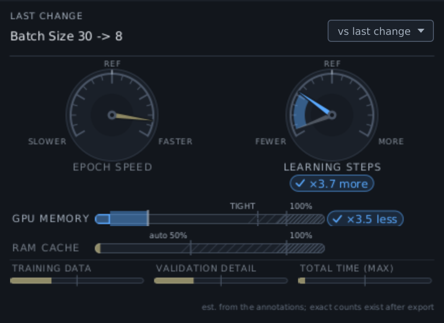
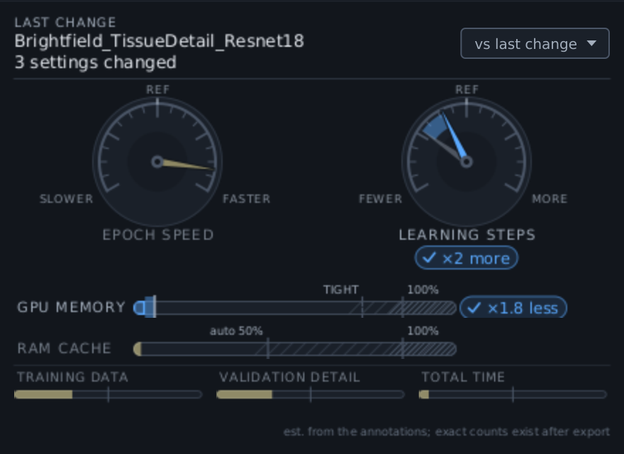

# Training HUD walkthrough: one real dataset, two presets

This page follows one real training setup, from the BINA / I2K 2026 workshop, and shows what the
**Training HUD** says as you change it: two single settings first, then two complete presets.
Every figure on this page is the HUD as it appeared for these exact steps on this data. For what
each gauge means, see the [Training Guide](TRAINING_GUIDE.md#training-hud-see-what-a-change-did).

> The Training HUD arrives in the release after 0.9.26. If your **Train DL Pixel Classifier**
> dialog has no **Training HUD** button in its bottom row, update the extension first.

## What you need

- **The workshop's brightfield tiles:** `Brightfield demo.zip`
  ([direct download](https://drive.google.com/uc?export=download&id=1ghskMkToAP6DoQSfGxrdQiOKjIMpHtI0),
  90 MB; Google shows a scan-warning page for a file this size, so click through it). Unzip it and
  open `project.qpproj` in QuPath.
- **The guide's annotations:**
  [`Brightfield_Tile1_training.geojson`](https://github.com/MichaelSNelson/BINA-I2K-2026-QuPath-Extensions/blob/main/data/dl-pixel-classifier/Brightfield_Tile1_training.geojson)
  and
  [`Brightfield_Tile4_validation.geojson`](https://github.com/MichaelSNelson/BINA-I2K-2026-QuPath-Extensions/blob/main/data/dl-pixel-classifier/Brightfield_Tile4_validation.geojson).
- **The two presets,** both saved training profiles:
  - **Preset A, quick overlay:** [`Brightfield_TissueDetection_Resnet18.json`](examples/Brightfield_TissueDetection_Resnet18.json),
    the workshop's own profile. ResNet-18 U-Net at 8x downsample, batch 30, half the patches
    held out for validation, early stopping on.
  - **Preset B, more detail:** [`Brightfield_TissueDetail_Resnet18.json`](examples/Brightfield_TissueDetail_Resnet18.json),
    the settings of the workshop's provided `CMU-1_Tissue_ResNet-18` model saved as a profile.
    The same network at 4x downsample, batch 4, 20% validation, early stopping off.

## Set up

1. **Open `Tile 1.ome.tif` and drag `Brightfield_Tile1_training.geojson` onto it; do the same for
   `Tile 4.ome.tif` with the validation file.** Then **`File > Save`**: the training dialog reads
   what the project has stored, not what is on screen.
2. **Open `Extensions > DL Pixel Classifier > Train DL Pixel Classifier...`.**
3. **In Training Data Source, tick `Tile 1.ome.tif` and `Tile 4.ome.tif`,** and set their roles
   to **Train** and **Val**, so one image trains and the other validates. The role drop-downs
   appear in the full view: click **Show All Settings** at the top right if you do not see them.
4. **Click Load Classes from Selected Images.**
5. **Click Training HUD** in the dialog's bottom row. The panel opens beside the dialog.

Nothing is colored yet: nothing has changed. The **REF** mark on each dial is where you
started. Your starting needles depend on your saved preferences, which set the dialog's
defaults; the changes below are what matter.

## A preset: one change, many settings

**Click Load profile... and choose `Brightfield_TissueDetection_Resnet18.json`** (preset A).

The profile set seven controls at once, and the HUD treats that as **one change** named after
the profile. Hover over the header for the full list. Against the dialog's defaults it changed
the encoder (ResNet-34 to ResNet-18), the tile size, the resolution (1x to 8x), the overlap, the
epochs, the batch size and mixed precision.

- **Epoch speed says `? not comparable`.** The encoder changed, and speeds of different networks
  cannot honestly be compared from settings alone, so the HUD does not guess.
- **Learning steps: ! ×39 fewer.** 8x downsample leaves about a tenth of the patches, and batch
  30 takes them thirty at a time.
- **GPU memory ✓ ×2.7 less, RAM cache ✓ ×39 less.** It is a light run.

This is the trap the HUD exists for: preset A is quick and light because it learns from much less.
For this two-class tissue-versus-background problem that is fine, and the workshop model trained
well. For finer structures it would not be.

## Two single settings

1. **Set Resolution from 8x to 4x.**

The reverse of the trap: about 3.3 times the patches, so every epoch is about 3.3 times slower
and the run buys 3 times the learning steps. **The two big dials swing in opposite directions,**
and the right-hand end is the good end on both. GPU memory did not move: each patch is the same
size; there are more of them.

2. **Set Batch Size from 30 to 8.**

A smaller batch means more optimizer steps for the same data (✓ ×3.7 more) and much less GPU
memory per step (✓ ×3.5 less). The speed dial does not move because it counts pixels processed,
and the pixels are the same. In practice a smaller batch often runs somewhat slower on a GPU;
the HUD does not model that, so take the unmoved speed needle as "about the same work", not as
"exactly as fast".

## A second preset, and comparing presets

**Click Load profile... again and choose `Brightfield_TissueDetail_Resnet18.json`** (preset B).

Switching presets is one change, however many settings differ. After the two edits above you
were only three settings from preset B: the validation split (50% to 20%), early stopping (on to
off) and the batch size (8 to 4). The validation split moved nothing: your two images have fixed
**Train** and **Val** roles, so the split percentage is not used.

Now **open the `vs last change` menu at the top right and choose
`Brightfield_TissueDetection_Resnet18`**: every loaded profile is in that list, along with
**Start** (where you began) and anything you pin.

This is the comparison of the two presets themselves: four settings apart (resolution, validation
split, early stopping, batch size). Preset B costs about 3.3 times the run time and 3.3 times the
RAM for its cache. In return it trains on 3.3 times the data with 22 times the learning steps,
and uses a sixth of the GPU memory. The REF mark on each dial has moved to preset A, so the
needles read "B relative to A".

Two more choices in the same menu:

- **Start** shows everything you changed since you opened the panel.
- **last change** goes back to judging one edit at a time.

## What the numbers are, and are not

- **Relative, not absolute.** "×3.3 slower" is the ratio of the work per epoch, not a time. How
  long an epoch takes depends on your GPU, and the HUD does not pretend to know it.
- **Patch counts are estimated from the annotations** before any pixel is read, by the same
  sampler the export uses. The export then drops patches that fail the coverage filters, so the
  real numbers in the training log run a little lower.
- **Memory is your machine's.** The GPU bar is your card's share and the RAM bar is your free
  RAM's, so your bars will not match these figures. They were rendered on a Linux machine
  without a GPU attached, with the dialog told the card has 24 GB (an RTX 3090); the GPU estimate
  itself is the extension's own.
- **No verdict on the whole configuration.** Each gauge is judged on its own. Whether ×22 more
  learning steps is worth ×3.3 the time is your call, and depends on how hard the problem is.

The figures are rendered from the real Train dialog on this data by
`harness/TrainingHudWalkthroughScenario.java`, so they can be regenerated whenever the HUD
changes.
